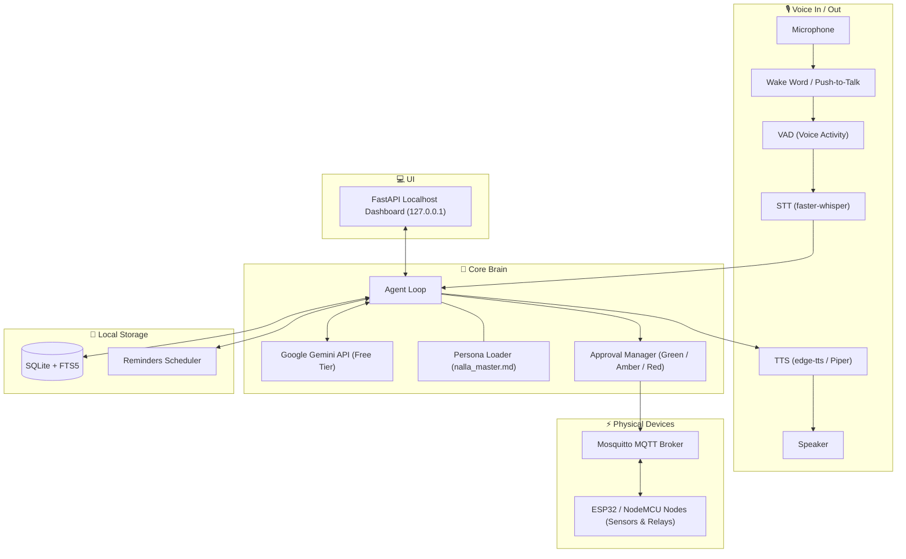

<div align="center">

# 🌟 NALLA SIVAM

### *Think smart. Speak naturally. Act responsibly. Stay curious.*

**A local-first, JARVIS-style personal AI companion with *anbu*.**  
Listens, reasons with Google Gemini, talks back, remembers locally in SQLite, and controls physical IoT gadgets over MQTT.

[](LICENSE)
[](https://www.python.org/)
[](https://fastapi.tiangolo.com/)
[](#-architecture)
[](#-esp32--iot-integration)

---

</div>

## 📖 The Name & Inspiration

- **NALLA (நல்ல):** "Good" in Tamil. It serves as the wake word (*"Nalla!"* &rarr; *"Yes boss, sollunga!"*). As an acronym: **N**ot **A**nother **L**ame **L**ogical **A**ssistant.
- **SIVAM (சிவம்):** Auspicious, good. Inspired by the spirit of the film *Anbe Sivam* (2003): goodness is demonstrated through actions, honesty, attention, and reliability — never false flattery or simulated feelings.

---

## 🏛 Architecture

One central brain operating locally on your machine with swappable components and strict safety gates:



---

## ✨ Features (MVP v1)

- 🗣️ **Conversational Voice Pipeline:** Wake word / push-to-talk $\to$ VAD $\to$ `faster-whisper` on CPU $\to$ `edge-tts` (Tamil & Indian English) with offline `Piper` fallback.
- 🛡️ **Safety & Approval Model:** 
  - 🟢 **GREEN:** Low-risk, automatic execution (e.g., get time, read sensors).
  - 🟡 **AMBER:** Requires user confirmation first (e.g., toggle relays, delete memories).
  - 🔴 **RED:** Explicit step-by-step confirmation every time.
- 🤝 **The Honesty Rule:** Nalla *only* says "Done" after a physical device or tool confirms an acknowledgement (`ok: true`). It never fakes success.
- 🧠 **Persistent Local Memory:** SQLite with FTS5 full-text search. Transparent, inspectable, and hard-deletable anytime.
- 🔌 **Hardware/IoT Ready:** Connect and command ESP32/NodeMCU sensor nodes and relays over MQTT.
- 🖥️ **Localhost Dashboard:** FastAPI + vanilla JS/HTML dark-mode console binding strictly to `127.0.0.1`.

---

## 🚦 Roadmap & Phases

| Phase | Component | Focus & Deliverable |
| :---: | :--- | :--- |
| **0** | **Scaffold** | Project layout, environment configuration, Gemini connectivity tests |
| **1** | **Brain & Persona** | Tool registry, persona prompt, approval manager, terminal chat |
| **2** | **Dashboard** | Localhost FastAPI server, live logs, settings manager, web chat |
| **3** | **Memory** | SQLite FTS5 store, recall injection, reminder engine |
| **4** | **Voice Pipeline** | `faster-whisper` (STT), `edge-tts`/`Piper` (TTS), push-to-talk |
| **5** | **ESP32 & MQTT** | Mosquitto broker setup, ESP32 telemetry, command-ack loop |
| **6** | **Polish** | Health checks, single launcher, diagnostics, demo checklist |

---

## 🛠 Tech Stack

| Category | Technology | Purpose |
| :--- | :--- | :--- |
| **Language** | Python 3.11+ | Core service logic |
| **Brain / LLM** | Google Gemini (google-genai SDK) | Reasoning engine (Free Tier) |
| **Web Server** | FastAPI + Uvicorn | Localhost dashboard & WebSocket events |
| **Speech-to-Text** | `faster-whisper` | Low-latency local CPU transcription |
| **Text-to-Speech** | `edge-tts` / `Piper` | Natural Tamil & English voices + offline fallback |
| **Audio Capture** | `sounddevice` + `silero-vad` / `webrtcvad` | Voice detection & recording |
| **Database** | SQLite3 (FTS5 enabled) | Local memory, conversations, and reminders |
| **IoT Protocol** | Eclipse Mosquitto + `paho-mqtt` | Sensor reporting and device actuation |
| **Hardware** | ESP32 / ESP8266 (NodeMCU) | Physical switches, sensors, and OLED display |

---

## 🚀 Getting Started

### 1. Prerequisites
- **Python 3.11+**
- **Git**
- A free **Google Gemini API Key** from [Google AI Studio](https://aistudio.google.com/)
- *(Optional for IoT)*: Mosquitto MQTT broker installed locally

### 2. Installation

```bash
# Clone the repository
git clone https://github.com/ugesh-ragavan/N.A.L.L.A-Sivam.git
cd N.A.L.L.A-Sivam

# Create and activate virtual environment
python -m venv venv
# On Windows:
.\venv\Scripts\activate
# On Linux/macOS:
source venv/bin/activate

# Install dependencies (Phase 0+)
pip install -r requirements.txt
```

### 3. Configuration

Copy the example environment file and configure your keys:
```bash
cp .env.example .env
```

Edit `.env`:
```ini
GEMINI_API_KEY=your_actual_gemini_api_key_here
GEMINI_MODEL=gemini-2.5-flash
LOG_LEVEL=INFO
WEB_PORT=8000
MQTT_HOST=localhost
MQTT_PORT=1883
```

---

## 🎙️ Wake Word & Custom "Nalla" Model Training

Nalla Sivam supports both **Push-To-Talk** (hotkey / dashboard button) and continuous **Wake Word Detection** using `openWakeWord` on CPU.

### Default Keyword
By default, Nalla comes pre-configured with the built-in model `"hey jarvis"` (or `"alexa"`).
To use it in `.env`:
```ini
WAKE_WORD_ENGINE=openwakeword
WAKE_WORD_KEYWORD=hey jarvis
WAKE_WORD_SENSITIVITY=0.5
FOLLOW_UP_TIMEOUT=30.0
FOLLOW_UP_ENABLED=true
```

### Training a Custom "Nalla" (நல்ல) Wake Word Model
To train your own custom wake word model that detects *"Nalla"*:

1. **Open the Training Colab:**
   Visit the official openWakeWord automated model training notebook on Google Colab:
   [openWakeWord Training Notebook](https://colab.research.google.com/github/dscripka/openWakeWord/blob/main/notebooks/automatic_model_training.ipynb)
2. **Configure the Target Phrase:**
   Set the target wake word to `Nalla` (you can also provide phonetic spellings or variations like `nalla`, `nallaa`).
3. **Generate Synthetic Training Clips:**
   The notebook utilizes Text-to-Speech engines (Piper / Coqui) to synthesize thousands of training clips in diverse accents and tones.
4. **Train and Export:**
   Train the lightweight binary classifier and export the model as an ONNX model: `nalla.onnx` (or `nalla.tflite`).
5. **Install into Nalla:**
   Place the exported file into your local models directory:
   ```bash
   mkdir -p data/models/wakeword
   cp nalla.onnx data/models/wakeword/nalla.onnx
   ```
6. **Activate via Configuration:**
   In your `.env` (no code modifications needed):
   ```ini
   WAKE_WORD_ENGINE=openwakeword
   WAKE_WORD_KEYWORD=data/models/wakeword/nalla.onnx
   WAKE_WORD_SENSITIVITY=0.5
   ```

### ⚡ Voice Features (Phase 4B)
- **Barge-in:** Saying the wake word or pressing the hotkey/button while Nalla is speaking (`SPEAKING` state) immediately halts playback and begins listening to your new instruction.
- **30-Second Follow-up Window:** When Nalla completes a response, it remains alert for 30 seconds. You can ask follow-up questions directly without repeating the wake word. If no speech is heard for 30s, it transitions back to `IDLE`.
- **Tamil-English Bilingual Support:** Auto-detects Tamil (`ta`) or English (`en`) queries, automatically routing to `ta-IN-PallaviNeural` for Tamil text and `en-IN-NeerjaNeural` for English text.

---

## 📸 Control Center Dashboard (HUD v2.0) — Screenshot Checklist

The localhost web interface at `http://127.0.0.1:8000` is redesigned as a futuristic, glassmorphic HUD control center.

| Feature / Page | View Details & Visual Verification Checklist | Hotkey / Route |
| :--- | :--- | :--- |
| **Centerpiece Orb (Home)** | Interactive canvas orb with 3D particle rings, dynamic breathing glow (IDLE), sonar ripples (LISTENING), gyroscopic gyro rings (THINKING), radiating waveform pulses (SPEAKING), and red flicker (ERROR). Status strip below with live telemetry. | `1` or `#home` |
| **Push-To-Talk & Mic Control** | Big PTT button, mic mute toggle, stop playback button, and quick action chips (`"What time is it?"`, `"Remember this"`, `"Set reminder"`). | `Space` / `M` |
| **Conversational Chat** | Modern chat bubbles (user & Nalla avatars), markdown rendering, collapsible tool-call inspection cards showing arguments, execution status, and results. | `2` or `#chat` |
| **Voice Studio** | Neural EdgeTTS & offline Piper voice selector, live audio test button, rate/pitch/volume sliders, profiles ("Warm Companion", "Robotic Butler", "Tamil Native"), STT model selector, live microphone energy level meter. | `3` or `#voice` |
| **Personality Studio** | Sliders for Sarcasm (0-10), Warmth (0-10), Tamil mix (0-100%), Verbosity; 4 modes (Friend, Jarvis, Focus, Engineer); editable `persona/nalla_master.md` with save/revert; live system prompt preview; **instant Test Chat box** testing unsaved slider settings live. | `4` or `#personality` |
| **Durable Memory Bank** | Responsive card grid with instant SQLite FTS5 search, category filters (preference, fact, project, person, task), inline editing, hard delete, add memory form, JSON backup export. | `5` or `#memory` |
| **Reminders & Tasks** | Countdown list with due timestamps, status badges (pending, done), quick add form, mark done button, snooze (+15m, +30m, +60m). | `6` or `#reminders` |
| **IoT Hardware Fleet** | ESP32 / ESP8266 device cards (Relay, DHT22 Climate Sensor, Bedroom Fan, Smart Plug) with online/offline dots, sensor gauges, SVG sparklines, control toggles with ACK state transitions, command history. | `7` or `#devices` |
| **Performance Waterfall** | Real-time per-turn latency waterfall breakdown (STT, Memory search, Prompt build, LLM 1st token, TTS 1st audio, total duration), average metrics cards, requests today counter, clear metrics button. | `8` or `#performance` |
| **Unified Activity Log** | Timeline event chronicle for speech turns, tool executions, and system events with category filter pills (`All`, `Voice`, `Tools`, `Memory`). | `9` or `#activity` |
| **Settings & Danger Zone** | Masked Gemini API key with reveal toggle, chat/command model selection, color theme picker (Cyan, Violet, Amber, Green), sound effects toggle, keyboard shortcuts guide, danger zone (wipe memories with typed `DELETE` confirmation). | `0` or `#settings` |
| **Command Palette (Ctrl+K)** | Floating fuzzy search modal to jump to any page or trigger actions (mute mic, trigger PTT, switch themes, switch modes, run tests). | `Ctrl+K` |
| **Approval Modal** | AMBER & RED risk tier modal gating sensitive tools with synthesized Web Audio chimes, description preview, Approve and Deny buttons. | Automated on AMBER |
| **Theme Switcher** | 4 Cyberpunk accent palettes (Cyan `#00f0ff`, Violet `#b05cff`, Amber `#f59e0b`, Green `#10b981`) dynamically updating all glows, borders, and controls via CSS variables. | Top HUD Bar |
| **Responsive Mobile View** | Sidebar collapses seamlessly to bottom navigation bar with touch-friendly controls on mobile viewports. | Responsive |

---

## 🔒 Security & Privacy Rules

1. **Localhost Bound:** Web interfaces bind strictly to `127.0.0.1` — no remote exposure.
2. **Secrets Protection:** API keys and credentials live in `.env` or `secrets.h`, never logged and never returned via the API.
3. **No Hallucinated Actions:** Actions without explicit tool verification return honest failures.
4. **Data Ownership:** SQLite database lives on your hard drive. Deleting a memory performs a permanent hard delete.

---

## 📄 License & Acknowledgements

- **License:** Distributed under the [MIT License](LICENSE).
- **Acknowledgements:**
  - Inspired by the movie *Anbe Sivam* (2003) for the core philosophy of compassion and honest service.
  - JARVIS for the aesthetic and functional style goal.
  - Developed under the **Why.axis** ecosystem by Ugesh.
