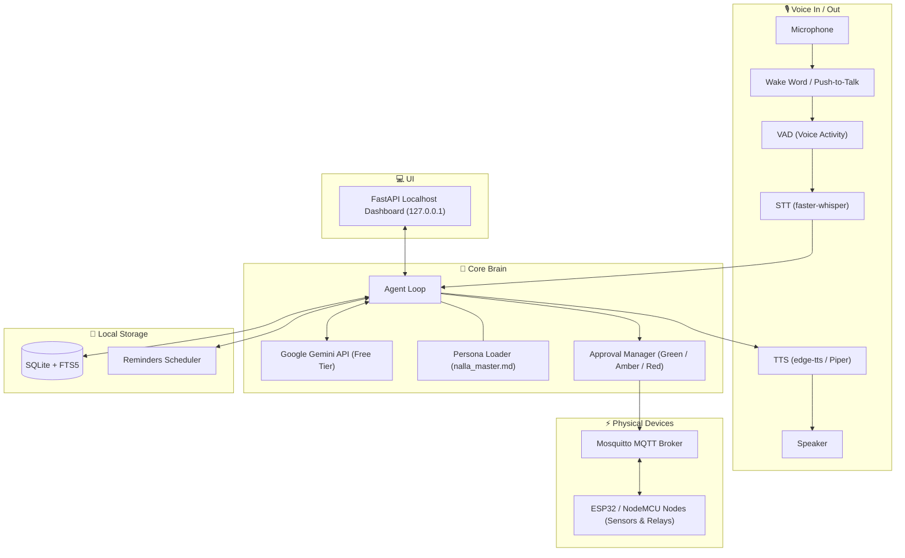

<div align="center">

# 🌟 NALLA SIVAM

### *Think smart. Speak naturally. Act responsibly. Stay curious.*

**A local-first, JARVIS-style personal AI companion with *anbu*.**  
Listens, reasons with Google Gemini, talks back, remembers locally in SQLite, and controls physical IoT gadgets over MQTT.

[](LICENSE)
[](https://www.python.org/)
[](https://fastapi.tiangolo.com/)
[](#-architecture)
[](#-esp32--iot-integration)

---

</div>

## 📖 The Name & Inspiration

- **NALLA (நல்ல):** "Good" in Tamil. It serves as the wake word (*"Nalla!"* &rarr; *"Yes boss, sollunga!"*). As an acronym: **N**ot **A**nother **L**ame **L**ogical **A**ssistant. No robotic, customer-support voice.
- **SIVAM (சிவம்):** Auspicious, good. Acronym: **S**iripudan **I**nidhaai **V**azhum **A**nbu **M**anidhan (*"the loving person who lives sweetly with a smile"*). Inspired by the spirit of the film *Anbe Sivam* (2003): goodness is demonstrated through actions, honesty, attention, and reliability — never false flattery or simulated feelings.

---

## 🏛 Architecture

One central brain operating locally on your machine with swappable components and strict safety gates:



---

## ✨ Features (MVP v1)

- 🗣️ **Conversational Voice Pipeline:** Wake word / push-to-talk $\to$ VAD $\to$ `faster-whisper` on CPU $\to$ `edge-tts` (Tamil & Indian English) with offline `Piper` fallback.
- 🛡️ **Safety & Approval Model:** 
  - 🟢 **GREEN:** Low-risk, automatic execution (e.g., get time, read sensors).
  - 🟡 **AMBER:** Requires user confirmation first (e.g., toggle relays, delete memories).
  - 🔴 **RED:** Explicit step-by-step confirmation every time.
- 🤝 **The Honesty Rule:** Nalla *only* says "Done" after a physical device or tool confirms an acknowledgement (`ok: true`). It never fakes success.
- 🧠 **Persistent Local Memory:** SQLite with FTS5 full-text search. Transparent, inspectable, and hard-deletable anytime.
- 🔌 **Hardware/IoT Ready:** Connect and command ESP32/NodeMCU sensor nodes and relays over MQTT.
- 🖥️ **Localhost Dashboard:** FastAPI + vanilla JS/HTML dark-mode console binding strictly to `127.0.0.1`.

---

## 🚦 Roadmap & Phases

| Phase | Component | Focus & Deliverable |
| :---: | :--- | :--- |
| **0** | **Scaffold** | Project layout, environment configuration, Gemini connectivity tests |
| **1** | **Brain & Persona** | Tool registry, persona prompt, approval manager, terminal chat |
| **2** | **Dashboard** | Localhost FastAPI server, live logs, settings manager, web chat |
| **3** | **Memory** | SQLite FTS5 store, recall injection, reminder engine |
| **4** | **Voice Pipeline** | `faster-whisper` (STT), `edge-tts`/`Piper` (TTS), push-to-talk |
| **5** | **ESP32 & MQTT** | Mosquitto broker setup, ESP32 telemetry, command-ack loop |
| **6** | **Polish** | Health checks, single launcher, diagnostics, demo checklist |

---

## 🛠 Tech Stack

| Category | Technology | Purpose |
| :--- | :--- | :--- |
| **Language** | Python 3.11+ | Core service logic |
| **Brain / LLM** | Google Gemini (google-genai SDK) | Reasoning engine (Free Tier) |
| **Web Server** | FastAPI + Uvicorn | Localhost dashboard & WebSocket events |
| **Speech-to-Text** | `faster-whisper` | Low-latency local CPU transcription |
| **Text-to-Speech** | `edge-tts` / `Piper` | Natural Tamil & English voices + offline fallback |
| **Audio Capture** | `sounddevice` + `silero-vad` / `webrtcvad` | Voice detection & recording |
| **Database** | SQLite3 (FTS5 enabled) | Local memory, conversations, and reminders |
| **IoT Protocol** | Eclipse Mosquitto + `paho-mqtt` | Sensor reporting and device actuation |
| **Hardware** | ESP32 / ESP8266 (NodeMCU) | Physical switches, sensors, and OLED display |

---

## 🚀 Getting Started

### 1. Prerequisites
- **Python 3.11+**
- **Git**
- A free **Google Gemini API Key** from [Google AI Studio](https://aistudio.google.com/)
- *(Optional for IoT)*: Mosquitto MQTT broker installed locally

### 2. Installation

```bash
# Clone the repository
git clone https://github.com/ugesh-ragavan/N.A.L.L.A-Sivam.git
cd N.A.L.L.A-Sivam

# Create and activate virtual environment
python -m venv venv
# On Windows:
.\venv\Scripts\activate
# On Linux/macOS:
source venv/bin/activate

# Install dependencies (Phase 0+)
pip install -r requirements.txt
```

### 3. Configuration

Copy the example environment file and configure your keys:
```bash
cp .env.example .env
```

Edit `.env`:
```ini
GEMINI_API_KEY=your_actual_gemini_api_key_here
GEMINI_MODEL=gemini-2.5-flash
LOG_LEVEL=INFO
WEB_PORT=8000
MQTT_HOST=localhost
MQTT_PORT=1883
```

---

## 🔒 Security & Privacy Rules

1. **Localhost Bound:** Web interfaces bind strictly to `127.0.0.1` — no remote exposure.
2. **Secrets Protection:** API keys and credentials live in `.env` or `secrets.h`, never logged and never returned via the API.
3. **No Hallucinated Actions:** Actions without explicit tool verification return honest failures.
4. **Data Ownership:** SQLite database lives on your hard drive. Deleting a memory performs a permanent hard delete.

---

## 📄 License & Acknowledgements

- **License:** Distributed under the [MIT License](LICENSE).
- **Acknowledgements:**
  - Inspired by the movie *Anbe Sivam* (2003) for the core philosophy of compassion and honest service.
  - JARVIS for the aesthetic and functional style goal.
  - Developed under the **Why.axis** ecosystem by Ugesh.
