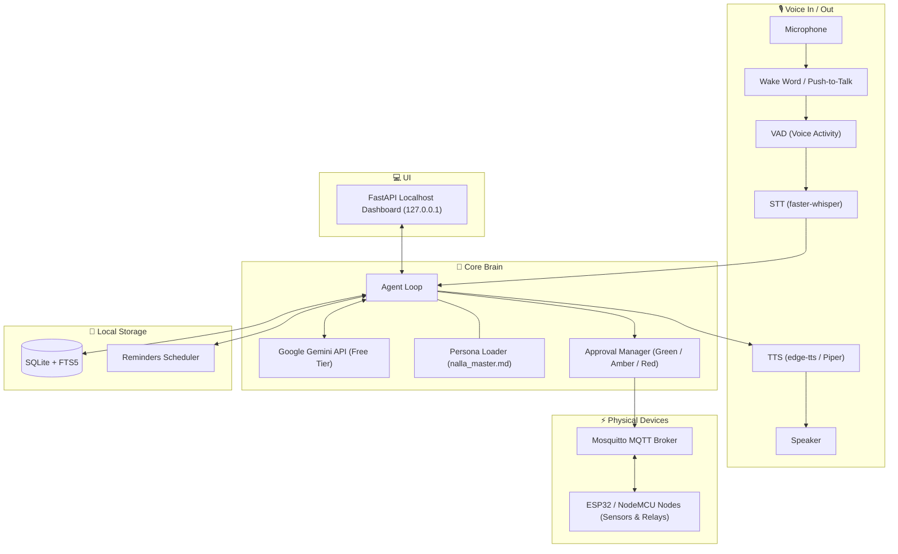

<div align="center">

# 🌟 NALLA SIVAM

### *Think smart. Speak naturally. Act responsibly. Stay curious.*

**A local-first, JARVIS-style personal AI companion with *anbu*.**  
Listens, reasons with Google Gemini, talks back, remembers locally in SQLite, and controls physical IoT gadgets over MQTT.

[](LICENSE)
[](https://www.python.org/)
[](https://fastapi.tiangolo.com/)
[](#-architecture)
[](#-esp32--iot-integration)

---

</div>

## 📖 The Name & Inspiration

- **NALLA (நல்ல):** "Good" in Tamil. It serves as the wake word (*"Nalla!"* &rarr; *"Yes boss, sollunga!"*). As an acronym: **N**ot **A**nother **L**ame **L**ogical **A**ssistant.
- **SIVAM (சிவம்):** Auspicious, good. Inspired by the spirit of the film *Anbe Sivam* (2003): goodness is demonstrated through actions, honesty, attention, and reliability — never false flattery or simulated feelings.

---

## 🏛 Architecture

One central brain operating locally on your machine with swappable components and strict safety gates:



---

## ✨ Features (MVP v1)

- 🗣️ **Conversational Voice Pipeline:** Wake word / push-to-talk $\to$ VAD $\to$ `faster-whisper` on CPU $\to$ `edge-tts` (Tamil & Indian English) with offline `Piper` fallback.
- 🛡️ **Safety & Approval Model:** 
  - 🟢 **GREEN:** Low-risk, automatic execution (e.g., get time, read sensors).
  - 🟡 **AMBER:** Requires user confirmation first (e.g., toggle relays, delete memories).
  - 🔴 **RED:** Explicit step-by-step confirmation every time.
- 🤝 **The Honesty Rule:** Nalla *only* says "Done" after a physical device or tool confirms an acknowledgement (`ok: true`). It never fakes success.
- 🧠 **Persistent Local Memory:** SQLite with FTS5 full-text search. Transparent, inspectable, and hard-deletable anytime.
- 🔌 **Hardware/IoT Ready:** Connect and command ESP32/NodeMCU sensor nodes and relays over MQTT.
- 🖥️ **Localhost Dashboard:** FastAPI + vanilla JS/HTML dark-mode console binding strictly to `127.0.0.1`.

---

## 🚦 Roadmap & Phases

| Phase | Component | Focus & Deliverable |
| :---: | :--- | :--- |
| **0** | **Scaffold** | Project layout, environment configuration, Gemini connectivity tests |
| **1** | **Brain & Persona** | Tool registry, persona prompt, approval manager, terminal chat |
| **2** | **Dashboard** | Localhost FastAPI server, live logs, settings manager, web chat |
| **3** | **Memory** | SQLite FTS5 store, recall injection, reminder engine |
| **4** | **Voice Pipeline** | `faster-whisper` (STT), `edge-tts`/`Piper` (TTS), push-to-talk |
| **5** | **ESP32 & MQTT** | Mosquitto broker setup, ESP32 telemetry, command-ack loop |
| **6** | **Polish** | Health checks, single launcher, diagnostics, demo checklist |

---

## 🛠 Tech Stack

| Category | Technology | Purpose |
| :--- | :--- | :--- |
| **Language** | Python 3.11+ | Core service logic |
| **Brain / LLM** | Google Gemini (google-genai SDK) | Reasoning engine (Free Tier) |
| **Web Server** | FastAPI + Uvicorn | Localhost dashboard & WebSocket events |
| **Speech-to-Text** | `faster-whisper` | Low-latency local CPU transcription |
| **Text-to-Speech** | `edge-tts` / `Piper` | Natural Tamil & English voices + offline fallback |
| **Audio Capture** | `sounddevice` + `silero-vad` / `webrtcvad` | Voice detection & recording |
| **Database** | SQLite3 (FTS5 enabled) | Local memory, conversations, and reminders |
| **IoT Protocol** | Eclipse Mosquitto + `paho-mqtt` | Sensor reporting and device actuation |
| **Hardware** | ESP32 / ESP8266 (NodeMCU) | Physical switches, sensors, and OLED display |

---

## 🚀 Getting Started

### 1. Prerequisites
- **Python 3.11+**
- **Git**
- A free **Google Gemini API Key** from [Google AI Studio](https://aistudio.google.com/)
- *(Optional for IoT)*: Mosquitto MQTT broker installed locally

### 2. Installation

```bash
# Clone the repository
git clone https://github.com/ugesh-ragavan/N.A.L.L.A-Sivam.git
cd N.A.L.L.A-Sivam

# Create and activate virtual environment
python -m venv venv
# On Windows:
.\venv\Scripts\activate
# On Linux/macOS:
source venv/bin/activate

# Install dependencies (Phase 0+)
pip install -r requirements.txt
```

### 3. Configuration

Copy the example environment file and configure your keys:
```bash
cp .env.example .env
```

Edit `.env`:
```ini
GEMINI_API_KEY=your_actual_gemini_api_key_here
GEMINI_MODEL=gemini-2.5-flash
LOG_LEVEL=INFO
WEB_PORT=8000
MQTT_HOST=localhost
MQTT_PORT=1883
```

---

## 🎙️ Wake Word & Custom "Nalla" Model Training

Nalla Sivam supports both **Push-To-Talk** (hotkey / dashboard button) and continuous **Wake Word Detection** using `openWakeWord` on CPU.

### Default Keyword
By default, Nalla comes pre-configured with the built-in model `"hey jarvis"` (or `"alexa"`).
To use it in `.env`:
```ini
WAKE_WORD_ENGINE=openwakeword
WAKE_WORD_KEYWORD=hey jarvis
WAKE_WORD_SENSITIVITY=0.5
FOLLOW_UP_TIMEOUT=30.0
FOLLOW_UP_ENABLED=true
```

### Training or Buying a Custom "Nalla" (நல்ல) Wake Word Model
To use a custom wake word model that detects *"Nalla"* without any code changes:

#### Option A: Train via openWakeWord Colab (Free & Automatic)
1. **Open the Training Colab:**
   Visit the official openWakeWord automated model training notebook on Google Colab:
   [openWakeWord Training Notebook](https://colab.research.google.com/github/dscripka/openWakeWord/blob/main/notebooks/automatic_model_training.ipynb)
2. **Configure the Target Phrase:**
   Set the target wake word to `Nalla` (you can also provide phonetic spellings or variations like `nalla`, `nallaa`, `நல்ல`).
3. **Generate Synthetic Training Clips:**
   The notebook utilizes Text-to-Speech engines (Piper / Coqui) to synthesize thousands of training clips in diverse accents and tones.
4. **Train and Export:**
   Train the lightweight binary classifier and export the model as an ONNX model: `nalla.onnx` (or `nalla.tflite`).

#### Option B: Buy or Source Pre-Trained Keywords
- Custom keywords can be sourced or purchased through professional audio dataset providers, the openWakeWord community model repository, or trained with tools like Picovoice Console / Edge Impulse.
- Ensure the exported model is an ONNX (`.onnx`) or TFLite (`.tflite`) file compatible with 16 kHz 16-bit PCM input.

#### Activating by Configuration Only
1. Place the exported file into your local models directory:
   ```bash
   mkdir -p data/models/wakeword
   cp nalla.onnx data/models/wakeword/nalla.onnx
   ```
2. In your `.env` (or via the **Voice Studio** dashboard settings live):
   ```ini
   WAKE_WORD_ENGINE=openwakeword
   WAKE_WORD_KEYWORD=data/models/wakeword/nalla.onnx
   WAKE_WORD_SENSITIVITY=0.5
   ```
   No codebase changes required — Nalla dynamically loads the ONNX weights at startup or upon saving in Voice Studio.

### ⚡ Voice Features & Acoustic Performance (Phase 4B)
- **Barge-in Interruption (< 200 ms):** Saying the wake word or pressing the hotkey/button while Nalla is speaking (`SPEAKING` state) immediately halts speaker playback within 200 ms, joins the previous audio turn, and transitions to `LISTENING` for your new command.
- **30-Second Follow-up Window:** When Nalla completes a response, it automatically remains in `LISTENING` mode for 30 seconds (configurable via `FOLLOW_UP_TIMEOUT`). An active countdown badge (`⏱️ 30s`) appears on the Orb. If you speak within this window, Nalla responds without requiring the wake word again. If silence persists for 30s, it cleanly transitions back to `IDLE`.
- **Echo Control (Acoustic Isolation):** While Nalla is in `SPEAKING` state, the audio recorder stream is automatically muted and hardware capture is zeroed out in memory. This eliminates microphone acoustic feedback loops and prevents Nalla from transcribing its own voice.
- **🎧 Headphone Recommendation:** For optimal hands-free barge-in performance—especially at higher speaker volumes or in rooms with acoustic reverberation—wearing headphones or a headset is strongly recommended.
- **Tamil-English Bilingual Routing:** STT auto-detects English (`en`) and Tamil (`ta`) on every turn. Responses with Tamil characters or Tamil queries automatically route to Tamil voice profiles (`ta-IN-PallaviNeural`), while English turns use the primary voice profile (`en-IN-NeerjaNeural` or Gemini TTS).
- **Whisper `base` vs `small` Tamil Benchmark:** Run `python scripts/test_tamil_english.py --model all` to benchmark Whisper model accuracy across 10 mixed Tamil-English sentences. Whisper `small` can be activated live in Voice Studio or via `POST /api/voice/stt-settings` for superior colloquial Tamil accuracy.

---

## 📸 Control Center Dashboard (HUD v2.0) — Screenshot Checklist & Page Tour

The local web interface at `http://127.0.0.1:8000` is engineered as a high-density, cyberpunk glassmorphic HUD control center. The entire interface is 100% operable via keyboard shortcuts (`Space`, `M`, `Ctrl+K`, `?`, `Esc`, `1-9`, `0`) and the command palette.

### 📋 Visual Verification & Screenshot Checklist

| Feature / Overlay | Visual Verification Checklist | Route / Hotkey |
| :--- | :--- | :--- |
| **1. Home & Orb Centerpiece** | Canvas particle orb reacting dynamically to states (`IDLE`, `LISTENING`, `THINKING`, `SPEAKING`, `ERROR`). Telemetry status strip, quick-action chips, and real-time live transcript feed with speaker role badges. | `1` or `#home` |
| **2. Chat & Tool Inspector** | Modern bubbles, streaming text tokens, hidden expressive speech tags (`<chuckle>` stripped), rich tool-call cards with expandable inputs/outputs and confirmation states, copy and clear buttons. | `2` or `#chat` |
| **3. Voice Studio** | Multi-engine selector (Gemini 3.8 TTS, Neural EdgeTTS, Offline Piper), Voice Library with dialect filters (`Tamil`, `English (India)`), 5 named profiles, speaking rate/pitch/volume controls, live mic VU level meter. | `3` or `#voice` |
| **4. Personality Studio** | Sarcasm (0-10), Warmth (0-10), Tamil Mix (0-100%), Verbosity sliders; Presets ("Cool Friend", "Pure Jarvis", "Roast Mode", "Calm Night"); live prompt preview; ephemeral test chat box; dual-model comparator. Locked Identity Guard non-editable cards. | `4` or `#personality` |
| **5. Memory Bank** | SQLite FTS5 card grid, category pills (`Preference`, `Fact`, `Project`, `Person`, `Task`), importance rating stars (1-5), inline text edit, delete with confirmation modal, JSON backup export, and "Last Used Memories" panel. | `5` or `#memory` |
| **6. Reminders & Tasks** | Chronological task queue with countdown timers to due times, status badges (`PENDING`, `DONE`), quick-add datetime picker form, done toggle, and snooze buttons (`+15m`, `+30m`, `+60m`). | `6` or `#reminders` |
| **7. Devices Fleet (IoT)** | ESP32 / ESP8266 node telemetry cards with online/offline ping status, live sensor gauges (Temperature, Humidity), SVG sparklines, relay toggles with `ACK_CONFIRMED` states, and MQTT command audit table. | `7` or `#devices` |
| **8. Performance Waterfall** | Per-turn latency waterfall telemetry (STT capture, Memory retrieval, Prompt composition, LLM First Token, TTS First Audio chunk, Total turn duration), 50-turn averages, requests today counter, and cache hit metrics. | `8` or `#performance` |
| **9. Unified Activity Log** | Categorized timeline of speech turns, tool runs, approval decisions, and runtime errors. Category filter pills (`ALL`, `VOICE`, `TOOL`, `APPROVAL`, `ERROR`), search box, and JSON export. | `9` or `#activity` |
| **10. Settings & Danger Zone** | Masked Gemini API key with preview eye toggle, separate Chat Model and Command Model dropdowns, accent color theme picker (Cyan, Violet, Amber, Green), sound effects toggle with volume slider, data export/import, and SQLite memory wipe with typed confirmation. | `0` or `#settings` |
| **Command Palette Overlay** | Floating glassmorphic command palette with fuzzy search to jump to any page, switch personality modes, change themes, trigger voice actions, quick add reminders, or view system errors. | `Ctrl+K` |
| **Shortcuts Cheat-Sheet** | HUD glassmorphic modal listing every keyboard shortcut with high-contrast `<kbd>` badges. Dismissible with `Esc` or clicking outside. | `?` or `Shift+/` |
| **Last Error Details Modal** | Diagnostic popup surfacing the most recent runtime exception, subsystem name, timestamp, and a direct jump button to Activity Log. | Palette or Error event |
| **Action Approval Modal** | High-contrast AMBER / RED risk modal requiring explicit human approval before executing sensitive tools (relays, wipes, writes) with Web Audio approval chime. | Triggered by AMBER tool |

---

### 🗺️ Page-by-Page Tour

1. **Page 1: Home & Orb (`1`)**  
   The primary visual anchor. At the center sits the dynamic Canvas Orb featuring 3 concentric particle rings that pulse with breathing glows in `IDLE`, expand into sonic ripples in `LISTENING`, revolve rapidly into gyroscopic rings during `THINKING`, and emit radial audio wave spikes during `SPEAKING`. Quick action chips let you immediately trigger common requests (*"What time is it?"*, *"Remember this"*, *"Set a reminder"*), while the live transcript strip tracks your spoken conversation in real time.

2. **Page 2: Chat & Tool Inspector (`2`)**  
   A dedicated interface for deep conversational reasoning and inspection. Every tool call executed by the agent (such as local time retrieval, weather checks, or memory storage) renders as an interactive card displaying tool parameters, execution outcome, and latency. Expressive emotional speech tags like `<chuckle>` and `<sigh>` are stripped from text displays so the reading experience remains completely clean.

3. **Page 3: Voice Studio (`3`)**  
   The acoustic engine room. Seamlessly audition and configure TTS across Google Gemini TTS (`gemini-3.8-flash-lite-tts`, `gemini-3.8-flash-tts`), Microsoft Edge Neural voices (`ta-IN-PallaviNeural`, `en-IN-NeerjaNeural`), and offline Piper. Manage up to 5 custom named voice profiles, tune speech speed presets (*Relaxed*, *Normal*, *Quick*), test microphone input levels with live energy meters, and preview pronunciation overrides with live audio playback.

4. **Page 4: Personality Studio (`4`)**  
   Fine-tune Nalla's behavior and humor. Adjust 4 core sliders (Sarcasm, Warmth, Tamil mix, Verbosity) or click instant presets (*"Cool Friend"*, *"Pure Jarvis"*, *"Roast Mode"*, *"Calm Night"*). Inspect the live prompt composition before it reaches Gemini, test the unsaved settings in an ephemeral Test Chat sandbox, compare outputs side-by-side across two Gemini models, and edit few-shot dialogue examples. The foundational Identity Guard rules remain locked and tamper-proof.

5. **Page 5: Memory Bank (`5`)**  
   Your personal knowledge base. Browse and search SQLite memories using instant full-text search (FTS5). Filter by category (*Preference*, *Fact*, *Project*, *Person*, *Task*) or star importance (1 to 5). Edit memories directly inline, delete outdated information with safety prompts, or review the **Last Used Memories** panel to see exactly which context facts were injected into the most recent model turn.

6. **Page 6: Reminders & Tasks (`6`)**  
   A productivity queue with visible countdown timers for upcoming tasks. Quickly schedule reminders using natural datetime pickers, mark completed tasks with one click, or snooze reminders by 15, 30, or 60 minutes. Reminders persist in SQLite and trigger notifications automatically upon due time.

7. **Page 7: Devices Fleet (`7`)**  
   Hardware control deck for ESP32 and ESP8266 IoT nodes over local MQTT. Monitor temperature and humidity sensor telemetry with live SVG sparklines, toggle relays and smart plugs, track `ACK_CONFIRMED` states from microcontrollers, and inspect the historical command log.

8. **Page 8: Performance Waterfall (`8`)**  
   Real-time telemetry waterfall charting every millisecond of a voice turn: audio capture, STT transcription, memory retrieval, prompt construction, LLM time-to-first-token (TTFT), and TTS first-chunk synthesis. Displays 50-turn rolling averages, cache hit ratios, and today's total API token counters to keep performance blisteringly fast.

9. **Page 9: Activity Log (`9`)**  
   A searchable, filterable timeline auditing every system event, user query, tool invocation, human approval, and runtime exception. Allows exporting the event log as JSON for diagnostic analysis.

10. **Page 10: System Settings (`0`)**  
    Configure application-wide settings: toggle or reveal the Gemini API key, switch between `gemini-3.1-flash-lite` and `gemini-2.5-flash` for chat and command models, adjust the synthesized chime volume (0–100%), select your favorite HUD accent palette, and access the Danger Zone to purge local memory stores.

---

### ⌨️ Complete Keyboard Shortcuts Reference

| Shortcut | Action | Scope / Context |
| :--- | :--- | :--- |
| <kbd>Space</kbd> | Push-to-Talk (Start listening) | Global (when not typing in an input field) |
| <kbd>M</kbd> | Toggle microphone mute / unmute | Global (when not typing in an input field) |
| <kbd>Esc</kbd> | Stop speaking immediately & dismiss open modals | Global |
| <kbd>Ctrl</kbd> + <kbd>K</kbd> | Toggle Command Palette | Global |
| <kbd>?</kbd> or <kbd>Shift</kbd> + <kbd>/</kbd> | Toggle Shortcuts Cheat-Sheet overlay | Global (when not typing in an input field) |
| <kbd>1</kbd> | Navigate to Home & Orb | Global (when not typing in an input field) |
| <kbd>2</kbd> | Navigate to Chat & Tools | Global (when not typing in an input field) |
| <kbd>3</kbd> | Navigate to Voice Studio | Global (when not typing in an input field) |
| <kbd>4</kbd> | Navigate to Personality Studio | Global (when not typing in an input field) |
| <kbd>5</kbd> | Navigate to Memory Bank | Global (when not typing in an input field) |
| <kbd>6</kbd> | Navigate to Reminders & Tasks | Global (when not typing in an input field) |
| <kbd>7</kbd> | Navigate to IoT Devices Fleet | Global (when not typing in an input field) |
| <kbd>8</kbd> | Navigate to Performance Waterfall | Global (when not typing in an input field) |
| <kbd>9</kbd> | Navigate to Activity Log | Global (when not typing in an input field) |
| <kbd>0</kbd> | Navigate to System Settings | Global (when not typing in an input field) |

---

## 🔒 Security & Privacy Rules

1. **Localhost Bound:** Web interfaces bind strictly to `127.0.0.1` — no remote exposure.
2. **Secrets Protection:** API keys and credentials live in `.env` or `secrets.h`, never logged and never returned via the API.
3. **No Hallucinated Actions:** Actions without explicit tool verification return honest failures.
4. **Data Ownership:** SQLite database lives on your hard drive. Deleting a memory performs a permanent hard delete.

---

## 📄 License & Acknowledgements

- **License:** Distributed under the [MIT License](LICENSE).
- **Acknowledgements:**
  - Inspired by the movie *Anbe Sivam* (2003) for the core philosophy of compassion and honest service.
  - JARVIS for the aesthetic and functional style goal.
  - Developed under the **Why.axis** ecosystem by Ugesh.
